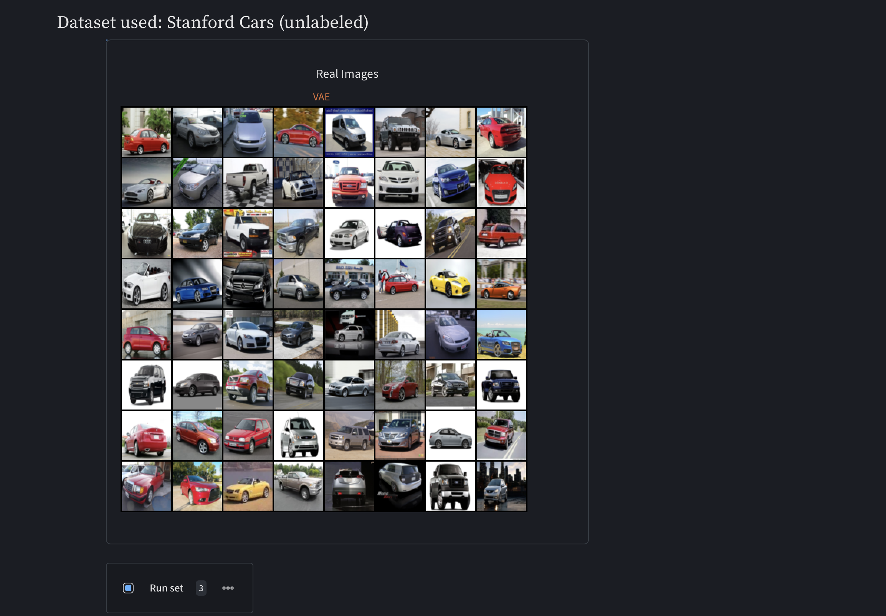
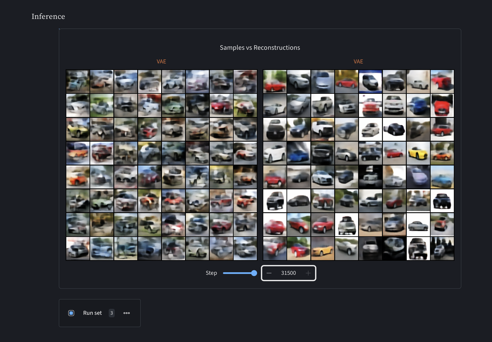
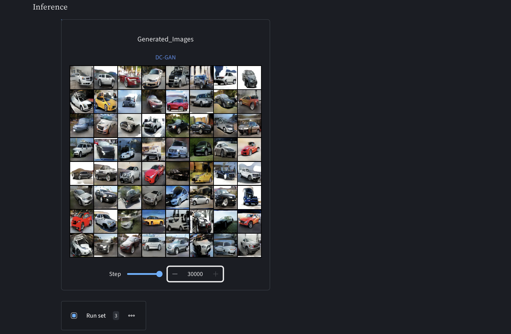
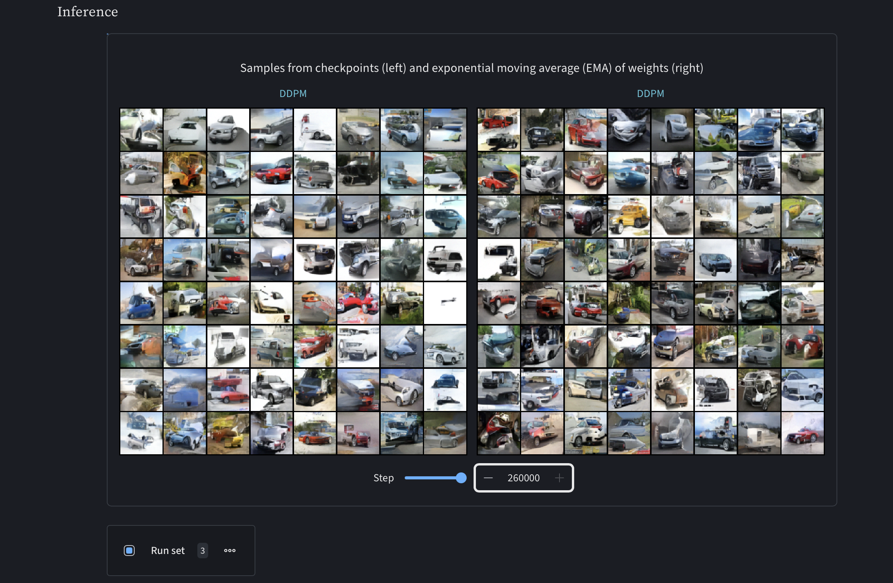

# Image-Based Generative Models

Code for three families of image generative models trained on the Stanford Cars dataset at 64×64 resolution: a convolutional Variational Autoencoder (VAE), a Deep Convolutional GAN (DCGAN) and a Denoising Diffusion Probabilistic Model (DDPM) sampled with DDIM. All three use the same data pipeline (`utils.py`), so their samples can be compared directly.

Some real training images (random horizontal flips, resized to 64×64):



---

## Theory

Please note that the theory corresponding to the codes is hosted on these pages:
- VAE: [Variational Autoencoders](https://parag1604.github.io/notes/Machine-Learning/Variational-Autoencoders)
- GAN: [Generative Adversarial Networks](https://parag1604.github.io/notes/Machine-Learning/Generative-Adversarial-Networks)
- DDPM: [Score-Based Models](https://parag1604.github.io/notes/Machine-Learning/Score-Based-Models) (its last section connects denoising score matching to DDPM; a dedicated diffusion lecture is planned)

## Python Environment Setup

Use python >= 3.10 and install the requirements:

```bash
pip install -r requirements.txt
```

- PyTorch - models, automatic differentiation and training (install the CUDA build; these models are meant to be trained on a GPU)
- Torchvision - `ImageFolder` data loading, transforms and image grids
- Weights & Biases (`wandb`) - logging of losses and sample grids (optional, see below)
- tqdm - progress bars while sampling from the diffusion model

## Data

The [Stanford Cars](https://doi.org/10.1109/ICCVW.2013.77) dataset (Krause et al., 2013) has 16,185 photos of 196 car models (8,144 train + 8,041 test). The original download page is no longer maintained, and torchvision's built-in downloader for it is broken; a copy already split into one folder per class is available on Kaggle (search for "Stanford Car Dataset by classes folder"). The data is not included in this repository.

Place it so that it looks like this (the default location is `./data/stanford_cars`; change it with `--data-path`):

```
data/stanford_cars/
├── train/
│   ├── Acura Integra Type R 2001/
│   │   ├── 00198.jpg
│   │   └── ...
│   └── ... (196 class folders)
└── test/
    └── ... (196 class folders)
```

Both splits are read with `torchvision.datasets.ImageFolder` and concatenated: the class labels are ignored, the models are unconditional. Images are resized to 64×64, randomly flipped horizontally and scaled to $[-1, 1]$.

## Running

Every script accepts `--data-path`, `--batch-size`, `--num-epochs`, `--learning-rate`, `--seed`, `--log-freq` (print losses every so many iterations), `--save-freq` (save weights to `models/` and 64-image sample grids to `samples/` every so many iterations) and `--max-iters` (stop early, for a quick check). Run `python <script>.py --help` for the rest; the defaults are the settings used for the results below.

Losses and sample grids are logged to [Weights & Biases](https://wandb.ai) (project `Generative-Models`). Pass `--wandb-entity <your team>` to log to a team, or `--wandb-mode disabled` to train without an account (the grids in `samples/` are still written).

Quick check that everything works (well under a minute per script on a GPU):

```bash
python vae.py --max-iters 300 --wandb-mode disabled
python gan.py --max-iters 300 --wandb-mode disabled
python ddpm.py --max-iters 300 --save-freq 250 --wandb-mode disabled
```

### Variational Autoencoder (`vae.py`)

```bash
python vae.py
```

An encoder of four strided convolutions (64×64 → 4×4) outputs the mean $\mu$ and log-variance $\log\sigma^2$ of $q(z\mid x)$ over a 128-dimensional latent; the decoder mirrors it with transposed convolutions and a `tanh` output.

- Reparameterization: $z = \mu + \sigma \odot \epsilon$, $\epsilon \sim \mathcal{N}(0, I)$.
- Loss per image: $\lVert x - \hat{x} \rVert_1 + \beta \, D_{\mathrm{KL}}\big(\mathcal{N}(\mu, \sigma^2) \,\|\, \mathcal{N}(0, I)\big)$, with $D_{\mathrm{KL}} = -\tfrac{1}{2}\sum_j (1 + \log\sigma_j^2 - \mu_j^2 - \sigma_j^2)$.
- The $\ell_1$ reconstruction term is the negative log-likelihood of a Laplace decoder (instead of the usual Gaussian/squared error), which gives slightly sharper reconstructions.
- KL annealing: $\beta$ grows linearly from 0 to 1 over the first half of the epochs, so the model first learns to reconstruct and only then is pulled towards the prior.

Samples from the prior (left) and reconstructions of a fixed batch of real images (right) after about 31,500 iterations (250 epochs):



The reconstructions are recognisable cars, but samples from $\mathcal{N}(0, I)$ are blurry and often malformed: the decoder only learns the regions of latent space that the encoder actually uses, and these do not cover the prior well.

### Deep Convolutional GAN (`gan.py`)

```bash
python gan.py
```

The DCGAN architecture of Radford et al. (2016): the generator maps $z \in \mathbb{R}^{100}$ through transposed convolutions with BatchNorm and ReLU (1×1 → 64×64, `tanh` output); the discriminator is a strided-convolution classifier with BatchNorm and LeakyReLU and a sigmoid output. Weights are initialised from $\mathcal{N}(0, 0.02^2)$, and both networks use Adam with learning rate $2\times10^{-4}$ and $\beta_1 = 0.5$.

- Objective: $\min_G \max_D \; \mathbb{E}_{x}[\log D(x)] + \mathbb{E}_{z}[\log(1 - D(G(z)))]$.
- Discriminator step: binary cross-entropy with label 1 for real and 0 for generated images.
- Generator step (non-saturating loss): minimise $-\log D(G(z))$, i.e. binary cross-entropy of $D(G(z))$ against the "real" label.

Samples from 64 fixed noise vectors after 30,000 iterations:



Much sharper than the VAE samples, with varied colours, viewpoints and backgrounds, although many bodies are distorted on close inspection. GAN losses do not tell you how good the samples are, so watch the sample grids.

### Denoising Diffusion Probabilistic Model with DDIM sampling (`ddpm.py`)

```bash
python ddpm.py
python ddpm.py --sampler ddpm   # sample with all T ancestral steps instead of DDIM
```

A forward process adds Gaussian noise over $T = 1000$ steps with a linear schedule $\beta_t$ from $10^{-4}$ to $0.02$; a small U-Net (residual blocks with GroupNorm, sinusoidal time embeddings, two down/up levels) learns to predict the noise.

- Forward process in closed form: $x_t = \sqrt{\bar\alpha_t}\, x_0 + \sqrt{1 - \bar\alpha_t}\, \epsilon$, with $\alpha_t = 1 - \beta_t$, $\bar\alpha_t = \prod_{s \le t} \alpha_s$, $\epsilon \sim \mathcal{N}(0, I)$.
- Training loss (simplified ELBO): $\lVert \epsilon - \epsilon_\theta(x_t, t) \rVert^2$ for a random $t$.
- DDPM ancestral step (`--sampler ddpm`): $x_{t-1} = \frac{1}{\sqrt{\alpha_t}}\big(x_t - \frac{\beta_t}{\sqrt{1 - \bar\alpha_t}}\, \epsilon_\theta(x_t, t)\big) + \sigma_t z$, with $\sigma_t^2 = \beta_t \frac{1 - \bar\alpha_{t-1}}{1 - \bar\alpha_t}$.
- DDIM step (default, deterministic with $\eta = 0$, 50 steps): $x_{t'} = \sqrt{\bar\alpha_{t'}}\, \hat{x}_0 + \sqrt{1 - \bar\alpha_{t'}}\, \epsilon_\theta(x_t, t)$, where $\hat{x}_0 = \big(x_t - \sqrt{1 - \bar\alpha_t}\, \epsilon_\theta(x_t, t)\big) / \sqrt{\bar\alpha_t}$.
- An exponential moving average (EMA, decay 0.9999) of the weights is kept, and samples are drawn from both the raw and the EMA weights. AdamW with a linear learning-rate warm-up over the first 5,000 steps.

Samples (DDIM, 50 steps) from the raw weights (left) and the EMA weights (right) after 260,000 iterations:



The samples are sharp and diverse; the EMA weights give somewhat more coherent cars. Diffusion models are the slowest of the three to train and to sample: each sample needs 50 network evaluations with DDIM (1,000 with the ancestral sampler).

## Tested

The result images in `static/` are from full training runs. After cleaning up the code, each script was re-run for a short check on an NVIDIA GB10 GPU (PyTorch 2.9, Stanford Cars train + test, 16,185 images) with `--wandb-mode disabled`:

- `vae.py --max-iters 300`: about 20 s; losses decrease, sample and reconstruction grids written.
- `gan.py --max-iters 300` (crosses the end of the first epoch, where the last batch is smaller): about 20 s.
- `ddpm.py --max-iters 300 --save-freq 250`: about 3 min including two rounds of DDIM sampling (raw and EMA weights); the loss goes from 1.04 to below 0.5.
- `ddpm.py --max-iters 1 --sampler ddpm`: one round of 1,000-step ancestral sampling with the raw and the EMA weights, about 3 min.

These short runs only check that the code trains and samples without errors; they are far from the quality shown above.
